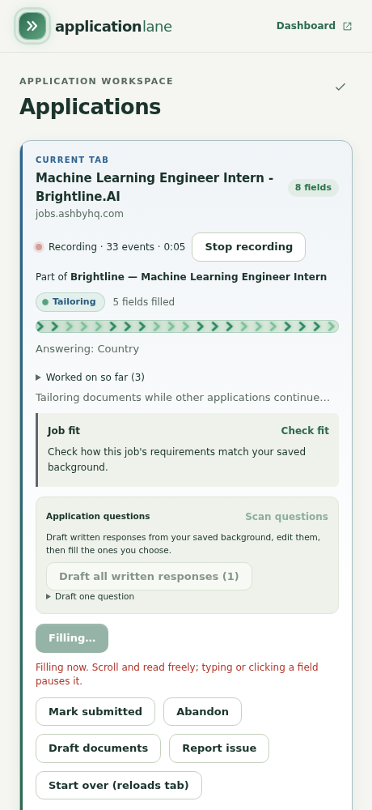
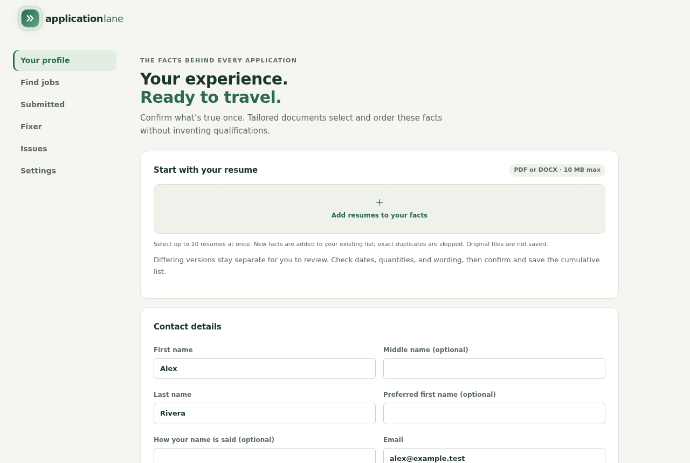
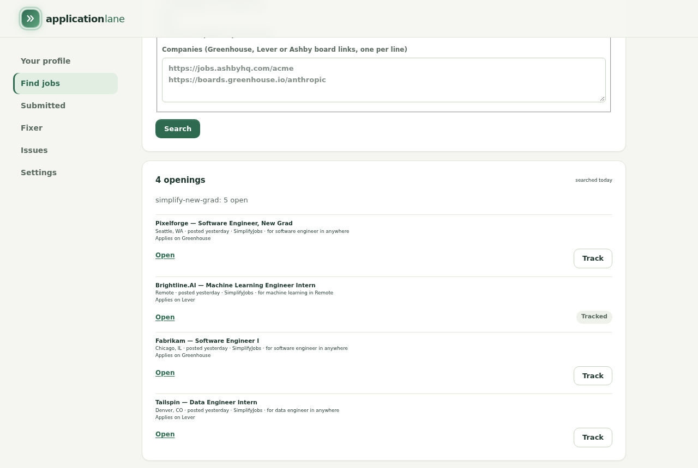
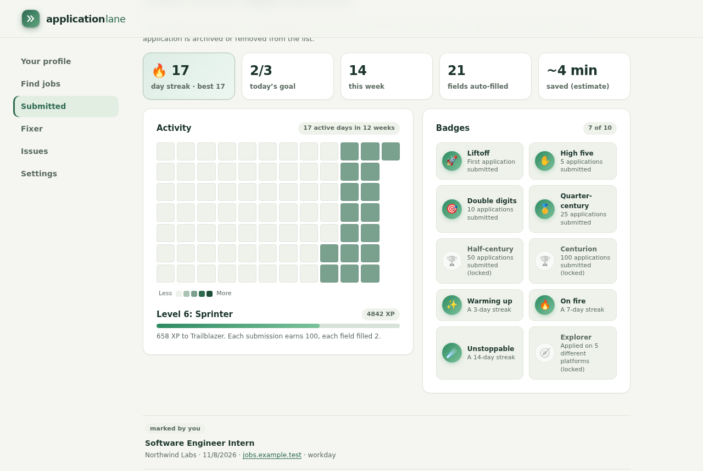

# Application Lane

Application Lane helps you fill out job applications faster without giving up control. It is a browser extension for Chrome (and other Chromium browsers) plus a small program, the backend, that runs on your own computer. Together they fill application forms from your résumé and profile, draft tailored résumés, cover letters and answers, and let you work on several applications at once.

It never submits anything for you. You review every step, press Next yourself, and press Submit yourself.

## Screenshots


| Side panel | Dashboard |
| --- | --- |
|  |  |
| **Find jobs** | **Progress** |
|  |  |

## Quick start

You need [Node.js 22](https://nodejs.org/) and desktop Chrome, Edge, Brave or another Chromium browser (version 120 or newer).

1. **Install Node 22, then get Application Lane.** Either clone this repository:
   ```bash
   git clone https://github.com/Nikman800/application-lane-public.git application-lane
   cd application-lane
   ```
   or download the two files from the latest GitHub release: `application-lane-extension-<version>.zip` (the extension) and `application-lane-backend-<version>.tgz` (the backend).
2. **Install and build.** From a clone:
   ```bash
   npm ci
   npm run build
   ```
   From a release: unzip the extension zip into a folder you will keep, and install the backend with `npm i -g ./application-lane-backend-<version>.tgz`.
3. **Start the backend.** From a clone run `npm start`; from a release run `application-lane`.
   The first start creates your settings automatically and prints a banner with the address (`http://127.0.0.1:4318`) and a **6-digit pairing code**. Leave this window open while you apply.
4. **Load the extension.** Open `chrome://extensions` (or `edge://extensions`), turn on **Developer mode**, choose **Load unpacked**, and select the `dist/extension` folder (or the folder you unzipped). Pin Application Lane to the toolbar if you like.
5. **Connect and follow the checklist.** Click the Application Lane icon, open **Dashboard**, choose **Connect to Application Lane on this computer**, and type the 6-digit code from the backend's window. The dashboard then shows a short checklist:
   - Connect backend
   - Choose how drafts are written (**Settings → Drafting**)
   - Import résumé (PDF or DOCX)
   - Review profile
   - Track your first application

`npm run setup` is optional. It asks in the terminal which drafting provider to use, if you prefer that to the Settings page.

Platform notes: [Windows](docs/windows-setup.md) · [macOS](docs/macos-setup.md) · [Linux](docs/linux-setup.md)

## How you use it

1. Open a job posting or application page. The side panel shows the fields it found. Choose **Track as new** to add it as an application, or attach the tab to an application you already track (for example a login page or an emailed link).
2. On each form step, choose **Fill this step**. Application Lane fills what it can from your confirmed profile and saved answers and attaches your tailored documents.
3. Check the page and fix anything you like, then press the site's **Next** or **Continue** button yourself. Repeat on the next step.
4. Submit the application yourself, then choose **Mark submitted**.

You can fill several applications at the same time; each one runs in its own lane. You can also paste a list of links into **Track application links** to queue them.

## What it does

- **Fills forms** from your confirmed profile: contact details, work and education history, links, common questions, and answers you saved before. It has site rules for Workday, Greenhouse, Lever, Ashby, iCIMS, SmartRecruiters, Workable, Oracle, Paylocity, JazzHR and Rippling, plus general form matching everywhere else.
- **Respects your edits.** The moment you type, click or pick something in a form, that application's fill pauses. Fields you have edited, or deliberately cleared, are not overwritten.
- **Imports your résumé.** Add PDF or DOCX résumés; facts are extracted on your computer, and you confirm them before they are used.
- **Drafts documents** tailored to each posting: a résumé and cover letter (PDF and DOCX) and answers to written questions. Every draft is shown for review, and claims your profile does not back up are flagged.
- **Checks fit.** **Check fit** compares a posting with your background and shows what matches, what is missing, and any eligibility issues.
- **Finds jobs.** The dashboard's **Find jobs** page searches public job lists and the job boards of companies you name.
- **Tracks progress.** The side panel's momentum card and the dashboard's progress board show your daily streak, today's goal, levels and badges.

## What it does not do

- It **never submits** an application and **never clicks Next, Continue or Submit** on its own.
- It does not sign, initial, tick consent boxes, solve CAPTCHAs, or log in for you.
- It does not invent facts: résumé bullets and saved answers use your own confirmed wording, and drafted text is checked against your profile.
- It only reads and drafts on LinkedIn and Indeed; it does not fill or scrape there.
- It does not collect telemetry or send your data to the project. There is no account.

Site rules are tested against sample forms, not every employer's setup. Some fields (unusual dropdowns, uploads, logins) may still need you.

## Privacy in short

Everything stays on your computer. The extension keeps its state in your browser, and the backend keeps your profile, documents and settings in a local data folder. Your profile facts and the job text are sent only to the drafting provider you choose, and only when it drafts something. Read the full [privacy policy](PRIVACY.md).

To delete your data, use **Dashboard → Settings → Your data → Delete local application data**, or delete the data folder (see [where your data lives](docs/advanced.md#where-your-data-lives)).

## Drafting providers

Choose who writes your drafts under **Dashboard → Settings → Drafting**:

| Provider | What you need |
| --- | --- |
| **Claude Code CLI** | [Claude Code](https://docs.anthropic.com/en/docs/claude-code) installed and signed in (`claude` on your PATH) |
| **Codex CLI** | [Codex CLI](https://github.com/openai/codex) installed and signed in (`codex` on your PATH) |
| **OpenAI-compatible API** | An endpoint URL (usually ending in `/v1`), a model name and, usually, an API key. The endpoint must support chat completions with JSON output. A chat subscription does not always include API access. |
| **None for now** | Filling still works from your profile. Drafting shows a button that takes you to **Settings → Drafting**. |

You can list several providers in order: if one fails or hits a usage limit, the next is tried. The page shows whether each CLI was found and lets you give its full path if it was not. Changes apply to the next draft without a restart.

Without any extra setup, résumés use a clean single-column layout that applicant tracking systems read well. If you keep your résumé in LaTeX, see [LaTeX tailoring](docs/advanced.md#latex-tailoring).

## Command line

With the backend running, you can manage applications from a terminal:

```bash
npm run lane -- add jobs.txt https://jobs.example.com/apply/123   # queue links, or files with one link per line
npm run lane -- status            # applications by stage, and what needs you
npm run lane -- failures          # fills that failed, and why (--json for scripts)
npm run lane -- watch             # print each change as it happens
npm run lane -- fill acme       # "Fill this step" on that application's tab
npm run lane -- switch acme     # bring its tab to the front
npm run lane -- search            # find openings with your saved Find jobs settings
npm run lane -- search add 1 3    # queue openings by their number
npm run lane -- ui                # full-screen view: ↑/↓ choose, f fill, s switch, a add links
```

If you installed the backend package, the same commands are available as `lane status`, `lane ui` and so on.

An application is named by the short id `status` shows (like `[fa4c3f]`) or by part of its company or title. `fill` does exactly what **Fill this step** does: it never presses Next or Submit.

## Themes and progress

Pick a theme under **Dashboard → Settings → Appearance**: **System** (Sage or Midnight, matching your computer), **Sage**, **Midnight**, **Ember**, **Aurora**, **Velocity** (the boldest fill animation) or **High contrast**. The same card sets your **daily goal** (3 a day by default).

The side panel's momentum card shows your streak, today's submissions against your goal, and your level, with a short celebration when you submit (a glow instead of confetti if your system asks for less motion). The dashboard's **Submitted** page has the full progress board: totals, the level track, a 12-week activity heatmap and milestone badges.

The command line uses the same themes: `npm run lane -- status --theme velocity`, or set `LANE_THEME=velocity`. The choices are `midnight` (default), `velocity`, `ember`, `aurora`, `sage` and `contrast`. Set `NO_COLOR=1` to turn colors off, or `FORCE_COLOR=0`…`3` to force a color depth. `LANE_GOAL` sets the daily goal the command line counts toward.

## Troubleshooting

**The extension says it is not connected.** Check that the backend window is still open and showed the `http://127.0.0.1:4318` banner. If you closed it, start it again, then choose **Refresh connection** under **Settings → Backend connection**.

**The pairing code is rejected or locked.** Type the code from the most recent banner. A code is accepted only while the backend is not yet paired, or within 10 minutes after you ask for a new one. After 5 wrong tries the code changes and pairing is locked for a minute; wait, then use the new code the backend prints.

**The backend is paired to another browser or extension.** Stop the backend and start it with `npm start -- --pair` (or `lane pair`). It prints a new code that works for 10 minutes; type it into the dashboard of the browser you want to use. As a fallback, open **Settings → Backend connection** and paste the 64-character token from `config.json` in your [data folder](docs/advanced.md#where-your-data-lives). Treat that token like a password.

**Port 4318 is already in use.** Another copy of the backend is probably running. Close the other window (find it with `lsof -i :4318` on macOS/Linux or `netstat -ano | findstr 4318` on Windows) and start again.

**Node version warning.** Application Lane supports Node 22. Older versions print a warning and may not work; check with `node --version`.

**WSL (Windows Subsystem for Linux).** You can run the backend inside WSL and Chrome on Windows; WSL makes `127.0.0.1` reachable from Windows. Drafted documents go to your Windows **Documents** folder. See [Windows setup](docs/windows-setup.md).

**After updating.** Run `npm run build` again, restart the backend, and press the reload button for Application Lane in `chrome://extensions`. Your profile and settings are kept.

**Something filled wrong.** Use **Report issue** in the side panel while the problem is visible. The report stays on your computer under **Issues** until you export or delete it. If you open a GitHub issue, please do not paste personal data.

## More documentation

- [Advanced use](docs/advanced.md): data folder, configuration reference, LaTeX tailoring, saved answers, AI filling settings, issue reports
- [Development](docs/development.md): building, tests, packaging
- [Architecture and limits](docs/architecture.md)
- [Privacy policy](PRIVACY.md) · [Security](SECURITY.md) · [Contributing](CONTRIBUTING.md) · [Changelog](CHANGELOG.md)

## License

MIT. See [LICENSE](LICENSE) and [THIRD_PARTY_NOTICES.md](THIRD_PARTY_NOTICES.md).
